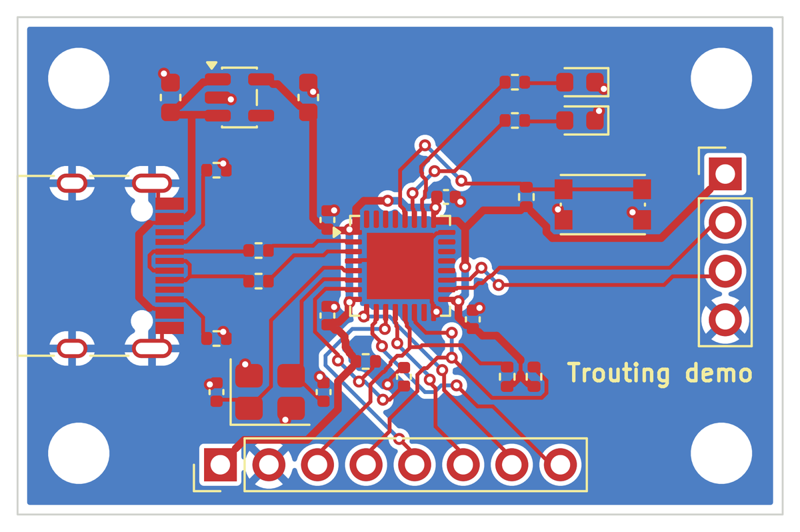

<p align="center"></p>

# Trouting: an autorouter for KiCad

Trouting (short for *Tommy's routing*) routes the tracks of a KiCad PCB for you. Give it a placed board with
a GND pour; it routes every net, stitches GND into the pour with vias, writes
the tracks back into the `.kicad_pcb` and runs KiCad's own DRC on the result.



*The demo board in `examples/demo/`, routed by Trouting in 24 seconds: 25
nets, every pad connected, no new DRC violations. Red is the front, blue is the GND
pour on the back with the back-side tracks cut into it.*

It is made for the boards most of us actually make: dense **2-layer boards with
a ground pour**, QFNs, an ESP32 module, fine-pitch connectors.

- **All nets at once.** It doesn't route one net after another and get stuck
  on the last few. Every net is routed every round, and spots that several
  nets want get more expensive each round (negotiated congestion, the
  PathFinder algorithm from FPGA routing). The net that has another way moves;
  the one that needs the spot keeps it.
- **Understands pours.** GND isn't routed pad to pad: each pad gets a short
  track and a via into the pour. Trouting predicts how KiCad will fill the
  zones, so it knows which bits of pour will be cut off, and stitches those
  too. Thermal reliefs are checked the way KiCad's DRC checks them.
- **Your board's rules.** Clearances, track widths and via sizes come from
  the board's net classes (`.kicad_pro`) and custom rules (`.kicad_dru`).
  Power nets keep their width where it fits and narrow only where it doesn't,
  and you are told where.
- **Checked by KiCad.** After routing, KiCad's DRC runs on the result and
  Trouting reports any violation that wasn't there before.
- **Native to KiCad.** No Java and no Specctra DSN/SES export and import. It
  reads and writes the `.kicad_pcb` through KiCad's own Python module.

Status: young but working. On the public [PCBWorld](https://github.com/LGAI-Research/PCBWorld)
benchmark it routes all 119 boards fully connected and free of DRC errors (see Results). It runs
on Linux, Windows and macOS with KiCad 9 and 10.

## In KiCad: the plugin

Trouting can run from KiCad's PCB editor: a toolbar button routes the open
board, and Ctrl+Z takes the routes out again. When the board can't be routed
as placed, the result window lists the suggested moves, and "Make this move
and route again" does just that.

To install it, download the `trouting-…-pcm.zip` from the
[latest release](https://github.com/TommyHolt/trouting/releases/latest). In
KiCad, open **Plugin and Content Manager > Install from File**, pick the zip,
then restart the PCB editor. The same zip works on Linux, Windows and macOS.

From a checkout, `python3 tools/make_pcm.py` builds the zip into `dist/`, and
on Linux `tools/install_plugin.sh` links the plugin into KiCad instead, for
development.

The first time you click it, it asks to install numpy, scipy and shapely into
its own folder: a 55 MB download, with KiCad's pip (KiCad's AppImage has none:
then the plugin fetches the same packages from PyPI itself, each checked
against PyPI's SHA-256). The router runs in a
process of its own, so the editor stays responsive and you can cancel.

It works with KiCad 9 and 10 on Linux, 64-bit Windows and macOS (Apple
Silicon and Intel). On Linux it is tested with the KiCad 9 snap and KiCad's
AppImage. On Windows, on an Apple Silicon Mac and with the AppImage on Linux,
every change is tested on GitHub Actions with KiCad 9 and 10 from their
installers: the package install and the whole routing run, up to a clean DRC.
The Intel Mac build is made but not tested.

It routes 12 setups at once and keeps the best, so it is quicker the more cores
you have: the stuck demo below, suggestions included, takes about 7 minutes on
12 cores and over 20 on 4. It takes as long as it needs; `--max-minutes M`
stops it after M minutes, when each setup keeps its best try and the nets it
couldn't route are listed.

## From the command line

You need:

- **KiCad 9 or 10.** On Linux, tested with the snap (`sudo snap install kicad`); a
  normal install should also work if your system Python can `import pcbnew`.
  On Windows, the normal installer: Trouting finds KiCad in Program Files (or
  set `KICAD_PYTHON` to the `python.exe` in KiCad's `bin` folder). On macOS,
  KiCad in Applications: Trouting finds the Python inside `KiCad.app` (or set
  `KICAD_PYTHON`).
- **Python 3.9 or newer** with numpy, scipy, shapely and Pillow.
- **A C compiler**, for the search core, a small C file compiled the first time
  it runs. On Linux, gcc. On macOS, clang (`xcode-select --install`). On
  Windows, either gcc from MinGW-w64, or no compiler: copy
  `plugins/trouting/prebuilt/core-…-win32-amd64.dll` out of the release zip
  into `trouting/prebuilt/`.

```sh
git clone https://github.com/TommyHolt/trouting.git
cd trouting
pip install -r requirements.txt
```

Then:

```sh
./trouting.py board.kicad_pcb                      # route in place, keeps board.kicad_pcb.trouting-bak
./trouting.py board.kicad_pcb -o routed.kicad_pcb  # write somewhere else
./trouting.py board.kicad_pcb --keep-tracks        # keep the tracks already there, route the rest
./trouting.py board.kicad_pcb --png routed.png     # also draw the result: front red, back blue, vias white
```

On Windows, run it as `python trouting.py …`. On macOS, `python3 trouting.py …`
keeps the Mac awake while it routes (it uses `caffeinate`).

To try it on the demo board (a made-up USB-C microcontroller board, placed
but not routed):

```sh
./trouting.py examples/demo/demo.kicad_pcb -o demo-routed.kicad_pcb
./trouting.py examples/demo/stuck.kicad_pcb -o stuck-routed.kicad_pcb   # placed too tight: shows the suggestions
```

Close the board in KiCad first, or reload it after. Keep the `.kicad_pro` (and
`.kicad_dru`, if you have one) next to the `.kicad_pcb`: that is where the net
classes and rules are. Tracks you have **locked** in KiCad are kept.

It runs twelve router setups in parallel (one per core) and keeps the best: the
fewest unrouted connections, then the fewest vias, then the shortest copper.
A run looks like this:

```
reading board.kicad_pcb
  dumped 2 copper layers, 50 footprints, 70 pads, 13 nets, 0 tracks, 0 vias
board read: 1003 x 503 cells x 2 layers, 13 nets to join (0.8s)
  setup via  8.0, plane 1.0:  0 unrouted,   0 vias,    184 mm  (1 rounds, 0s)
  setup via  8.0, plane 1.5:  0 unrouted,  14 vias,    186 mm  (4 rounds, 1s)
  ...
best: via cost 8.0, plane cost 1.0
  applied 66 tracks, 0 vias
wrote board.kicad_pcb  (5s)

all connections routed
KiCad DRC: 0 unconnected pads (was 0)
  no new violations
```

### When a board can't be routed as placed

Then Trouting looks for a part to move or rotate. It takes the parts near the
connections it couldn't make and tries turning them and shifting them by 0.5
to 2 mm. A move must keep the part's courtyard clear of the other parts, its
pads clear of other copper, and the part as far inside the board as it was.
Trouting ranks the moves by how much shorter and less tangled the ratsnest
gets, then routes the whole board with each of the best ones. Only moves that
leave fewer connections unrouted are listed. On `examples/demo/stuck.kicad_pcb`
(the demo with U1 turned and C5 moved up):

```
not routed (3):
  ADC1                     U1.10
  SDA                      U1.13
  TX                       U1.11
  crowded at: (123.50, 112.30)
to make it route, move or rotate a part (each checked by routing the board with it):
  move C5 0.5 mm right and down (to 124.15, 114.15)  routes fully
  move C5 2.0 mm down (to 123.80, 115.80)            routes fully
  rotate U1 90° clockwise (to 0°)                    2 left unrouted
  move U1 1.0 mm down (to 120.00, 114.00)            2 left unrouted
```

This takes about as long again as the routing. `--no-suggest` skips it.

## Results

**PCBWorld** ([arXiv:2607.05915](https://arxiv.org/abs/2607.05915)), a public routing benchmark
on real open-source KiCad boards, scored by its own pipeline with KiCad's DRC. Clean pass: the
share of boards fully connected *and* with zero DRC errors.

| Set | Boards | Trouting | KiCadRoutingTools 0.24.1 | Freerouting | Best RL agent |
|---|---|---|---|---|---|
| D3-A | 99 | **1.00** | 0.92 | 0.80 | 0.94 |
| D3-B | 10 | **1.00** | 0.50 | 0.78 | 0.45 |
| D3-C | 10 | **1.00** | 0.50 | – | – |

KiCadRoutingTools is its current version (November 2026), run here with PCBWorld's own setup for
it; Freerouting's and the RL agent's numbers are the paper's. Both Trouting and KiCadRoutingTools
connect every board; the difference is DRC errors, and Trouting uses fewer vias (12.6 against 17.9
per D3-B board, 56 against 85 per D3-C board). The D3 boards are small to medium (D3-A: 6 to 31
pads); how it was run, the cross-checks and the caveats are in [docs/benchmarks.md](docs/benchmarks.md).

**37 boards with 4 or more layers** from the collection PCBWorld's boards come from (36 with 4
layers, one with 8 layers and 1585 pads), scored the same way. Clean pass:

| Trouting | KiCadRoutingTools 0.24.1 | The original hand routing |
|---|---|---|
| **34 of 37** | 8 of 37 | 36 of 37 |

Trouting's three misses are pins it can't get out from under dense chips.

**31 public, hand-routed boards** from GitHub (53 to 667 pads, six of them 4-layer): 28 end with
every pad connected. **Ten boards of our own** (2-layer, 3 to 64 nets): all ten.

## Limitations

What it doesn't do yet:

- **Escaping fine-pitch chips** (QFP, BGA) on dense boards: where many pins have to get out
  from under one chip, it can leave a few of them unrouted.
- **Big, dense boards can take hours.** A 4-layer board with 1151 pads and two fine-pitch chips
  still had about 30 connections unrouted after 3 hours.
- **Pours on nets other than the plane net** (a +3V3 pour, say) aren't
  modelled, so they can be left with isolated copper.
- **Differential pairs and length matching** are not supported.
- **Placement suggestions move one part at a time.** A board that needs two
  parts moved gets the move that helps most, and you run it again.

Bug reports with a board attached are the most useful thing you can send.

## How it works

| file | what it does |
|---|---|
| `trouting_kicad.py` | The only part that needs KiCad's Python (pcbnew). `dump` reads a board into JSON; `apply` writes the tracks and vias back and refills the zones. |
| `trouting/board.py` | The board as a grid at 0.05 mm: exact distance to fixed copper, board edge, keepouts and holes; the pads each net must join. |
| `trouting/core.c` | A* search and the occupancy bookkeeping, in C. |
| `trouting/router.py` | The negotiated-congestion rounds, GND stitching, the pour model, thermal checks, and rip-up and repair. |
| `trouting/cli.py` | The command: runs the setups in parallel, applies the best, runs DRC before and after. |
| `trouting/suggest.py` | Placement suggestions: moves near the trouble, screened by the ratsnest, checked by routing. |
| `trouting/parallel.py` | The worker processes: fork and pipes on Linux (KiCad's snap doesn't allow the semaphores `multiprocessing` needs), a spawn pool on Windows and macOS. |
| `trouting/job.py`, `plugin/` | The KiCad plugin: the dialogs, and the router run as a job of its own. |

## Developing

Test boards are not part of the repository, because they are other people's
designs. Put your own in `test/boards/`: the `.kicad_pcb` with its
`.kicad_pro` and `.kicad_dru` next to it. The folder is git-ignored. Judge
every change on all of them, not on one.

```sh
test/bench.sh                     # route them all; table in test/out/bench/summary.txt
test/bench.sh mine other          # just these (test/boards/mine.kicad_pcb, ...)
test/run.sh mine via_cost=8.0     # one setup, in-process (PNG of the result), then KiCad's DRC
python3 test/t_suggest.py mine scan          # turn each part, list the turns that stop it routing
python3 test/t_suggest.py mine fix U2:270    # break it so, then see what the suggestions find
```

## License

MIT. See [LICENSE](LICENSE).
